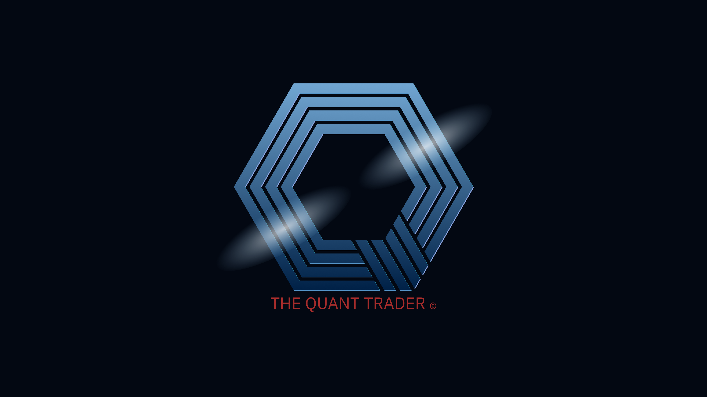

# Hi, I'm Denis Khorkin 👋

Quantitative developer focused on algorithmic trading and derivatives:
options, futures, volatility.

🔭 Currently working on Quant Terminal — a trading terminal in C++ and Qt.

🌱 Currently learning TimescaleDB.

## Tech Stack

- **Languages:** C++, Erlang/OTP, SQL
- **OS:** Linux
- **DB:** PostgreSQL
- **Frameworks:** Qt
- **Tools:** Vim, Git, Rebar3, CMake, Conan

## Education

- Lobachevsky State University of Nizhny Novgorod —
Master of Applied Computer Science (MACS)
- S.Y. Witte Moscow University — Bachelor of Economics (BEC)
